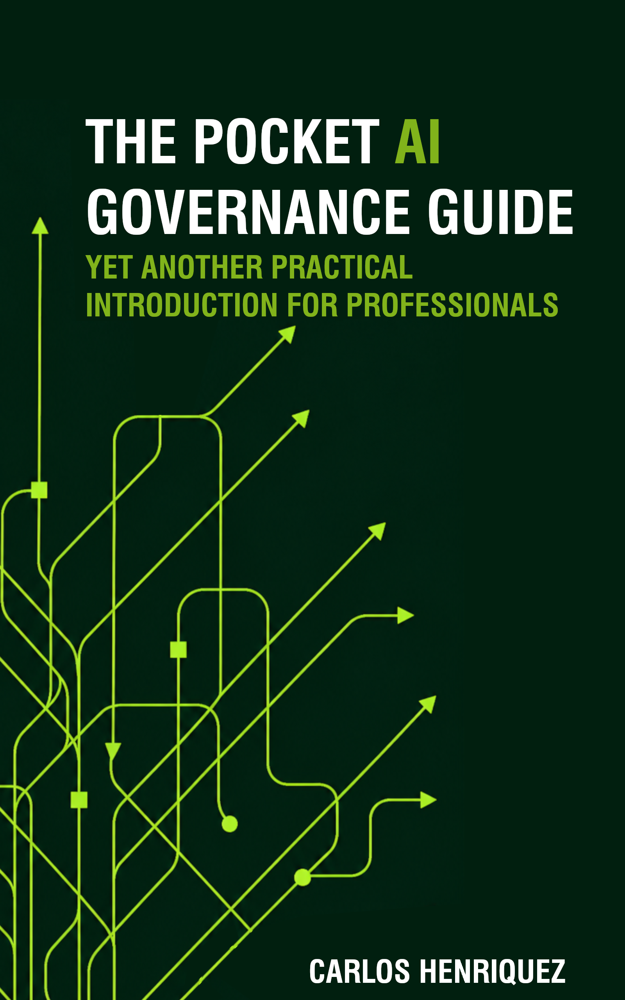

# The Pocket AI Governance Guide

### Yet Another Practical Introduction for Professionals

**By Carlos Henríquez**

Welcome to the official companion repository for **The Pocket AI Governance Guide**, the second publication in the Pocket Guide series.

This repository contains supplementary resources designed to help readers explore, evaluate, and apply the concepts of AI governance, risk management, accountability, and responsible technology adoption introduced in the book.

**[Get the book on Amazon](https://a.co/d/0bi6Uqhn)**

---

## About the Book

*The Pocket AI Governance Guide* examines the challenges introduced by artificial intelligence from an organizational and societal perspective, helping professionals develop a critical understanding of the responsibilities associated with adopting emerging technologies.

The book explores the relationship between artificial intelligence, human judgment, corporate governance, economic transformation, and cybersecurity.

It emphasizes informed decision-making, organizational resilience, and the importance of maintaining human accountability in an increasingly automated world.

## Companion Resources

The following resources complement the book and provide additional opportunities for practical learning and reflection on AI governance, risk, and organizational responsibility.

| Resource | Description | PDF |
|---|---|---|
| Resource 01 | Coming soon |  |
| Resource 02 | Coming soon |  |
| Resource 03 | Coming soon |  |
| Resource 04 | Coming soon |  |
| Resource 05 | Coming soon |  |

## How to Use These Resources

Each resource is provided as a PDF document.

Click **View PDF** to open the document in GitHub. From there, you can read it online or download a copy.

These materials are intended to complement the book, encourage critical reflection, and support informed decision-making regarding the adoption and governance of AI.

## Updates and Feedback

These materials may be revised as AI technologies, governance practices, and regulatory frameworks evolve.

Suggestions, corrections, and feedback are welcome through the repository's **Issues** section.

## About the Author

Carlos Henríquez is an architect, educator, and author based in Norway.

His work explores the practical application of emerging technologies, digital transformation, cybersecurity, and responsible technology adoption.

## Copyright and Usage

© 2026 Carlos Henríquez. All rights reserved.

Companion materials are provided for educational use. Specific permissions for reuse and redistribution will be described in the repository's licensing documentation.
